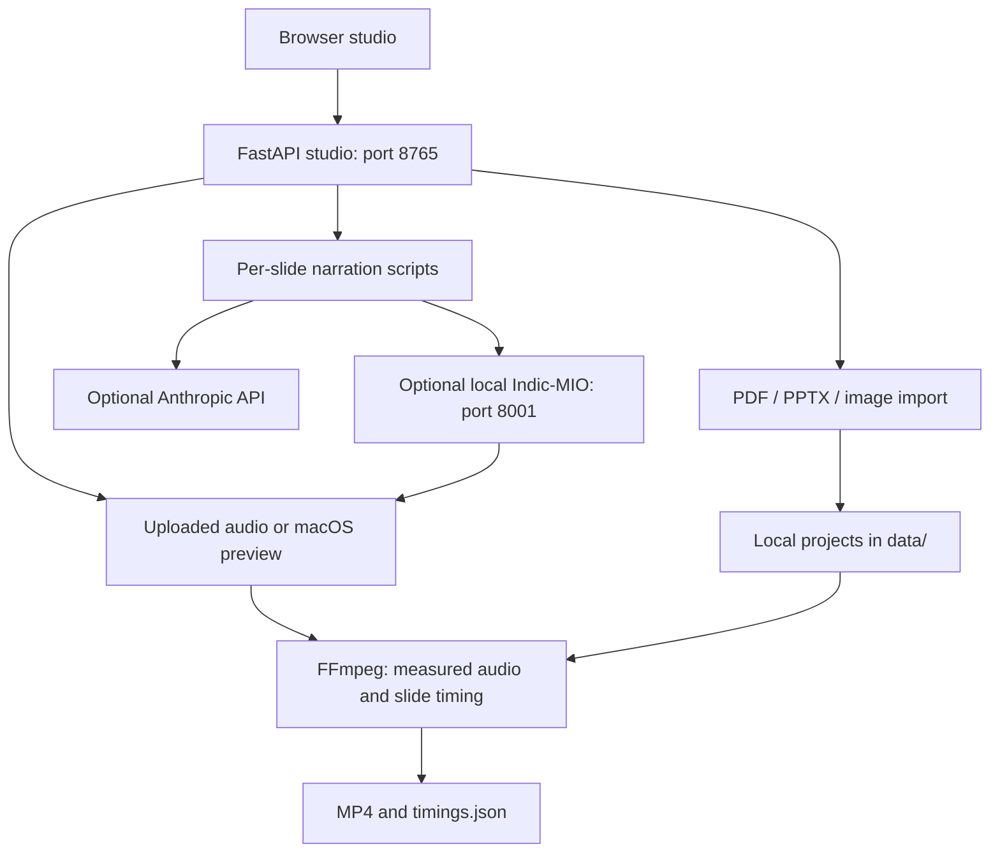

# Architecture

SlideVoice is a single-user FastAPI application with plain HTML, CSS, and JavaScript. The browser talks to a local studio server. Neural speech generation runs in a separate optional process so editing and exporting do not require PyTorch.

## Modules

| File | Responsibility |
| --- | --- |
| `app/main.py` | HTTP endpoints, background jobs, validation, and file access |
| `app/core.py` | Project persistence, per-project locks, and cache invalidation |
| `app/media.py` | Slide rendering, audio normalisation, timing, and video export |
| `app/providers.py` | Claude, MioTTS-compatible speech, and macOS speech adapters |
| `app/script_import.py` | Labelled-script splitting and AI boundary validation |
| `app/indic_server.py` | Optional Transformers/MioCodec speech server |
| `app/static/` | Browser interface with no frontend build step |
| `tests/` | Provider mocks, workflow validation, and real media integration tests |

## Project lifecycle

1. Import slides and extract any text and speaker notes.
2. Save per-slide scripts or preview/apply a full-script import.
3. Generate or upload audio; store the measured decoded duration.
4. Round slide durations up to video frames and add the chosen pause.
5. Render an H.264/AAC MP4 and export `timings.json`.

Changing a script clears that slide's audio and invalidates its prior video. Bulk audio generation preserves uploaded recordings and reuses compatible generated audio. Completed slides survive recoverable provider errors. Background job status is saved, but execution itself is not a durable queue: restart interrupts work, and the app marks interrupted jobs as failed on startup.

## Storage and privacy

`SLIDEVOICE_DATA_DIR` defaults to `data/`. Each project has a folder containing metadata (`project.json`), source files, slide images, scripts, reference recordings, narration, and exports. The bundled model server defaults its Hugging Face cache to `data/models/huggingface/`. These files and `.env` are excluded from Git.

Files are not encrypted at rest. Deleting a project requires stopping the server and removing its folder; do not delete the model cache's parent directory to troubleshoot downloads. Local voice cloning keeps narration and reference audio on the machine. Optional Claude calls send slide content, and a configured remote speech server receives narration and voice references.

## Local API

With the studio running, visit [Swagger UI](http://127.0.0.1:8765/docs) or [OpenAPI JSON](http://127.0.0.1:8765/openapi.json) for request schemas and routes. Mutation requests require `X-SlideVoice: local`; browser-origin requests must also match the local server origin. The browser client sets the required header.

Useful routes include `GET /api/health`, `GET /api/projects`, `POST /api/projects`, `POST /api/demo`, per-slide script editing, script preview/apply, narration generation, reference/audio uploads, and video rendering. Files are served through project-scoped API routes.

The optional voice server exposes `GET /health`, `GET /v1/presets`, and `POST /v1/tts`. It loads real models at startup; tests inject a fake engine to verify the protocol without downloading weights.

## Operational boundaries

Run one Uvicorn worker and bind to loopback. Locks are in-process, so multiple workers are unsupported. There is no authentication, durable queue, cancellation, or hosted deployment mode. See [SECURITY.md](../SECURITY.md) and the [README](../README.md) for limits.
